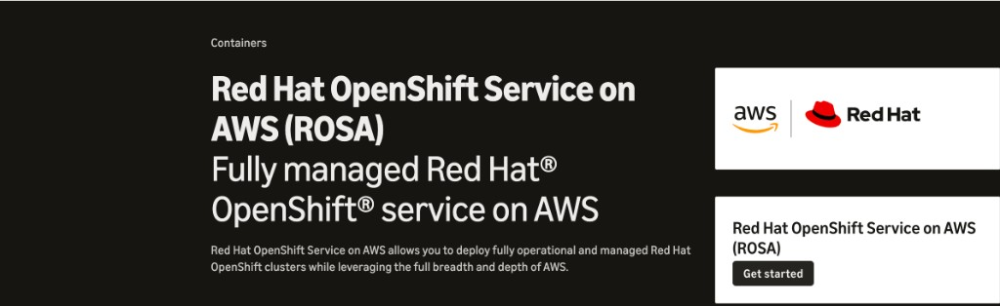
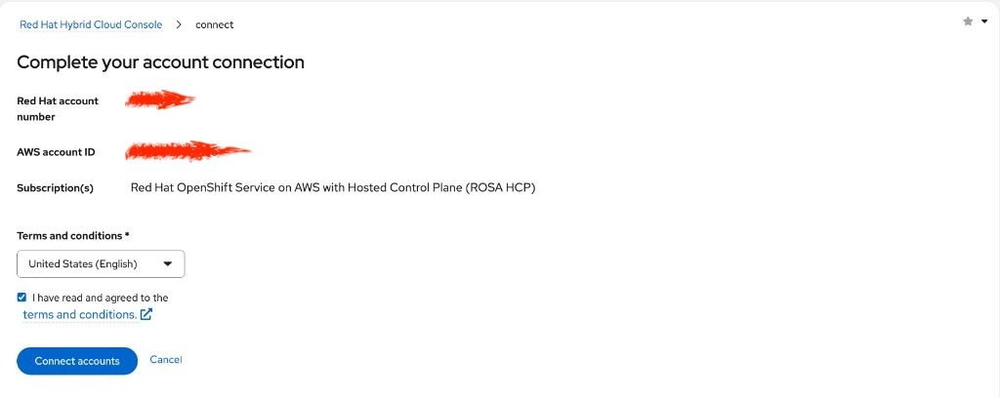

# Install guide — ROSA HCP 4.22 + optional OpenShift AI 3.5

macOS + Terminal. Target: empty AWS account (e.g. RHDP).

| Phase | Result | Time |
|-------|--------|------|
| **0** Prep | Tools, AWS profile, ROSA enable, billing, OCM token | 15–30 min |
| **1** ROSA | Public **multi-AZ** cluster, Tokyo `4.22.22`, **1× m6a.xlarge per AZ** | 35–50 min |
| **2** AI (optional) | RHOAI 3.5 + Karpenter CPU/GPU NodePools | 30–60 min |

**Note:** OCM may show HCP as “Multi-zone” even for old single-AZ worker VPCs (control plane is always multi-AZ). Worker multi-AZ = private subnets in multiple AZs (`multi_az = true` in tfvars).

## First run (short)

```bash
cd /path/to/rosa-rhoai-installer
./phase1/install_rosa.sh --tools-only
# Complete Phase 0 below (AWS keys + ROSA enable + billing + OCM token)
export AWS_PROFILE=rhdp_demo
./install.sh                 # recommended
```

---

## Which script to run

| Use this | When |
|----------|------|
| **`./install.sh`** | **Normal path:** runs Phase 1 (ROSA), then **asks** `Continue to Phase 2 - OpenShift AI 3.5? [y/N]`. Answer **`y`** to install AI now, or **`N`** to stop after ROSA (run Phase 2 later if needed). |
| `./phase1/install_rosa.sh` | ROSA only — no Phase 2 question. Also used for `--tools-only` / `--from=` / `--plan-only` below. |
| `./phase2/install_rhoai.sh` | OpenShift AI only (cluster already up + `oc` works). Same as `./install.sh --phase2-only`. |

```bash
cd /path/to/rosa-rhoai-installer
export AWS_PROFILE=rhdp_demo          # default name; override if needed

./install.sh                          # Phase 1 → ask [y/N] → optional Phase 2
./install.sh --skip-preflight-gates   # ROSA/billing/OCM already done
./install.sh --phase1-only            # Phase 1 only (no Phase 2 question)
./install.sh --phase2-only            # AI only
./install.sh --plan-only              # terraform plan, no apply
```

Phase 1 helpers (same as flags on `./install.sh` where noted):

```bash
./phase1/install_rosa.sh --tools-only
./phase1/install_rosa.sh --from=aws
./phase1/install_rosa.sh --from=preflight
./phase1/install_rosa.sh --from=inputs
./phase1/install_rosa.sh --plan-only
./phase1/install_rosa.sh --force      # overwrite existing clusters/<name>/
```

Do **not** run `make cluster.*` from inside `rosa-rhoai-installer/` — that lives in the sibling pattern repo (the installer `cd`s there for you).

---

## Layout

```text
parent/
  rosa-rhoai-installer/                 # this repo → ./install.sh
  validated-pattern-terraform-rosa/     # Terraform (auto-cloned if missing)
  rhoai-sno-setup-guide/                # Phase 2 (auto-cloned if missing)
  RHOAI-Toolkit/                        # Phase 2 (auto-cloned if missing)
```

Defaults: `lib/defaults.env`. Generated configs: `templates/` → cluster tfvars / NodePools / DSC.

---

## Re-pull GitHub repos

### Update this installer (already cloned)

```bash
cd /path/to/rosa-rhoai-installer
git pull origin main
```

Then continue as usual:

```bash
export AWS_PROFILE=rhdp_demo
./install.sh
```

### Update sibling repos (optional)

`./install.sh` **clones siblings if missing**; it does **not** pull them every run.

```bash
cd /path/to/parent   # folder that contains the siblings

git -C validated-pattern-terraform-rosa pull
git -C rhoai-sno-setup-guide pull          # if using Phase 2
git -C RHOAI-Toolkit pull                  # if using Phase 2
```

---

## Phase 0 — One-time prep

### 0.1 Tools

```bash
cd /path/to/rosa-rhoai-installer
./phase1/install_rosa.sh --tools-only
```

Needs: `git`, `jq`, `aws`, `terraform`, `rosa`, `oc`, `make` (via Homebrew).

### 0.2 AWS Access Key

```bash
./phase1/install_rosa.sh --from=aws
# or answer prompts during ./install.sh
export AWS_PROFILE=rhdp_demo
aws sts get-caller-identity
```

### 0.3 Enable ROSA (AWS Console) — manual

1. [AWS ROSA home](https://console.aws.amazon.com/rosa/home) → **Get started** → **Enable ROSA**.  
2. Wait until prerequisites are green; confirm **ROSA with HCP** is enabled.




### 0.4 Link AWS ↔ Red Hat billing — manual

1. Same flow → **Continue to Red Hat**.  
2. Confirm AWS account ID + **ROSA HCP** → **Connect accounts**.




### 0.5 OCM token — paste into installer

1. Copy token from [console.redhat.com/openshift/token](https://console.redhat.com/openshift/token).  
2. Paste when `./install.sh` asks (saved under `~/.config/ocm/offline-token`).

### 0.6 OCM IAM role

Done in preflight (`rosa create ocm-role` if needed). If you skipped gates and see org/AWS auth errors:

```bash
./phase1/install_rosa.sh --from=preflight
```

---

## Phase 1 — Create ROSA

```bash
export AWS_PROFILE=rhdp_demo
./install.sh
```

| Prompt | Default |
|--------|---------|
| Cluster name | (required) |
| Region | `ap-northeast-1` |
| OpenShift | `4.22.22` |
| Multi-AZ | **yes** |
| Workers | `m6a.xlarge`, **1 per AZ** |

Success: Console / API / admin password printed and saved under `state/access-*.txt`.

```bash
cat state/access-*.txt
# or: cd ../validated-pattern-terraform-rosa && make cluster.<name>.show-credentials
```

---

## Phase 2 — OpenShift AI (optional)

From `./install.sh` answer **yes**, or later:

```bash
./phase2/install_rhoai.sh
# or: ./install.sh --phase2-only
```

Order: Karpenter CPU+GPU NodePools → NFD/GPU Operator → RHODS 3.5 → sno scripts → HardwareProfile → verify.  
No model/Playground smoke in v1.

---

## Destroy

```bash
cd /path/to/validated-pattern-terraform-rosa
export AWS_PROFILE=rhdp_demo
export RHCS_TOKEN=$(tr -d '[:space:]' < ~/.config/ocm/offline-token)
export AUTO_APPROVE=true
make cluster.<name>.destroy
```

Clear local installer state: `rm -f state/cluster.env state/access-*.txt` (keep `state/README.md`).

Single-AZ → multi-AZ: **destroy and recreate** (cannot convert in place).
