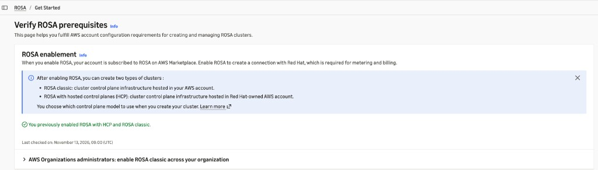
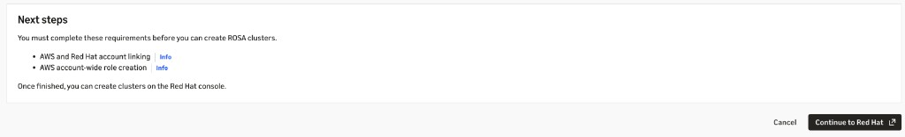

# Install ROSA HCP 4.22 + OpenShift AI 3.5 (RHDP)

Simple path for a **new empty AWS account** (for example from **RHDP**) using an Access Key + Secret Key.

| Phase | What you get | Typical time |
|-------|----------------|--------------|
| **0** Prep | Tools + AWS profile + Red Hat login | 15–30 min |
| **1** ROSA | Public OpenShift (default Tokyo 4.22), **2× m6a.xlarge** | 35–50 min |
| **2** OpenShift AI | RHOAI 3.5 + MaaS + Karpenter CPU/GPU pools | 30–60 min |

Phase 2 is optional. AI capacity uses **Karpenter on-demand NodePools** (not larger always-on workers).

**macOS + Terminal only.**

---

## Before you start

- [ ] Empty AWS account + Access Key / Secret Key  
- [ ] Red Hat account ([console.redhat.com](https://console.redhat.com))  
- [ ] Homebrew allowed on your Mac  
- [ ] Sibling repos available (see [README.md](./README.md))  
- [ ] OK with AWS cost for 2× `m6a.xlarge` (+ Karpenter nodes if you install AI)

**Do not** commit Access Keys, Secret Keys, OCM tokens, kubeconfigs, or anything under `state/` into git.

### Manual steps (by design — not scripted)

| Manual step | Why |
|-------------|-----|
| Enable ROSA HCP in AWS | Marketplace / console subscription |
| Link AWS billing ↔ Red Hat org | Cross-account browser connect |
| Copy OCM offline token (paste into installer like AK) | Issued only at console.redhat.com/openshift/token |

Screenshots under `docs/images/` are **UI examples**; your account numbers will differ.

---

## Commands you will use

```bash
cd /path/to/rosa-rhoai-installer

./install.sh                      # full guided flow
./phase1/install_rosa.sh          # Phase 1 only
./phase1/install_rosa.sh --tools-only
./phase1/install_rosa.sh --plan-only
./phase2/install_rhoai.sh         # Phase 2 only (after Phase 1)
```

Default AWS profile name: **`rhdp_demo`** (set in `lib/defaults.env`; override with `export AWS_PROFILE=...`).

Resume after a failure: `--from=preflight` (Phase 1) or `--from=rhods` (Phase 2).

### Already configured AWS / OCM / rosa manually?

| Option | Command / prompt |
|--------|------------------|
| Interactive | At preflight, answer **y** to *Skip detailed preflight gates?* then type **YES** |
| Flag | `./install.sh --skip-preflight-gates` |
| Skip preflight entirely | `./phase1/install_rosa.sh --from=inputs` (still needs working profile + OCM token for provision) |

Fast path still runs: `aws sts`, OCM token reuse/paste, `rosa whoami`, and OCM role ensure.

---

## Phase 0 — One-time setup

### Step 0.1 — Open this folder

```bash
cd /path/to/rosa-rhoai-installer
```

### Step 0.2 — Install tools

```bash
./phase1/install_rosa.sh --tools-only
```

Needs: `git`, `jq`, `aws`, `terraform`, `rosa`, `oc`, `make`. If Homebrew is missing, the script prints the install one-liner and stops.

### Step 0.3 — AWS profile from Access Key / Secret

```bash
./phase1/install_rosa.sh --from=aws
# or run full ./install.sh and answer prompts
```

When prompted, paste **Access Key ID** then **Secret Access Key** first (same idea as the OCM token).  
Then choose a profile name (default `rhdp_demo`) and region (default `ap-northeast-1`).  
If a working profile already exists, the script offers to reuse it.

```bash
export AWS_PROFILE=rhdp_demo
aws sts get-caller-identity
```

Write down: `My AWS Account ID: ________________`

### Step 0.4 — Enable ROSA (AWS Console) — **manual only**

> Not automated. Use the **same** AWS account as Step 0.3 (Incognito helps avoid mixing accounts).

#### 0.4.1 — Search ROSA → Get started

1. Sign in to the [AWS Console](https://console.aws.amazon.com/).  
2. Search for **ROSA** (or open [ROSA home](https://console.aws.amazon.com/rosa/home)).  
3. Click **Get started**.


#### 0.4.2 — Enable ROSA — all items green

1. Click **Enable ROSA**.  
2. On **Verify ROSA prerequisites**, wait until the page shows a **green** success state for ROSA enablement.  
3. Confirm **ROSA with HCP** is enabled (Classic may also show as enabled — that is OK). You will create **HCP** later, not Classic.



Example success text: *You previously enabled ROSA with HCP and ROSA classic.*

### Step 0.5 — Link AWS billing to Red Hat — **manual only**

> Not automated. Skip → cluster create fails with  
> `billing account not linked to organization at the aws marketplace`.

#### 0.5.1 — Continue to Red Hat

1. Stay on the ROSA Get Started / prerequisites flow.  
2. Scroll to the bottom **Next steps** section (AWS and Red Hat account linking, AWS account wide role creation).  
3. Click **Continue to Red Hat**.



#### 0.5.2 — Connect accounts

1. Sign in with the **Red Hat** account that will own the cluster.  
2. On **Complete your account connection**, verify:
   - **AWS account ID** matches Step 0.3 (`My AWS Account ID`)
   - Subscription lists **ROSA HCP** (Hosted Control Plane)
3. Accept **terms and conditions**.  
4. Click **Connect accounts**.


*(Account numbers in the screenshot are redacted.)*

When finished, return to the installer preflight gate and type `YES`.

### Step 0.6 — OCM offline token — **browser copy, paste into installer**

> Getting the token is manual (browser only). **Pasting it works like the AWS Access Key:** the installer prompts for it (hidden input) and saves `~/.config/ocm/offline-token` (mode 600).

1. Open [https://console.redhat.com/openshift/token](https://console.redhat.com/openshift/token) (same Red Hat account as Step 0.5).  
2. Copy the API token.  
3. When the installer asks **Paste OCM offline token**, paste it and press Enter.  
   (If a token file already exists, it asks whether to reuse it.)

The script then runs `rosa login` / `rosa whoami`. Confirm username and AWS account match. Wrong account → stop and fix billing/token.

### Step 0.7 — OCM role (automated in preflight)

Billing link (0.5) is **not** enough. The installer preflight runs:

```bash
rosa create ocm-role --admin --mode auto --yes   # if no Linked=Yes role yet
```

and ensures the ELB service-linked role exists. No manual step unless IAM permissions block role creation.

If you skipped preflight and see `Organization ... is not authorized to access AWS Account`, re-run:

```bash
export AWS_PROFILE=rhdp_demo
./phase1/install_rosa.sh --from=preflight --skip-preflight-gates
```

---

## Phase 1 — Create ROSA

```bash
export AWS_PROFILE=rhdp_demo
./install.sh
# or: ./phase1/install_rosa.sh
```

The script re-checks the three manual gates, asks for cluster settings, runs terraform plan, and **asks before apply**.

| Prompt | Default |
|--------|---------|
| Cluster name | (required) |
| Region | `ap-northeast-1` |
| OpenShift version | `4.22.22` |
| Type | `public` only |
| Workers | **`m6a.xlarge` × 2** |

### Success = access block printed

```text
 Phase 1 complete — ROSA access details
  Console URL:  https://console-openshift-console.apps....
  API URL:      https://api....:443
  Username:     admin
  Password:     ...
  Saved copy:   state/access-<name>.txt
```

Re-print: `cat state/access-<name>.txt` or  
`cd "$VALIDATED_PATTERN_DIR" && make cluster.<name>.show-credentials`

Dry run without create: `./phase1/install_rosa.sh --plan-only`

---

## Phase 2 — OpenShift AI 3.5 (optional)

Answer **yes** at the Phase 1 gate, or later:

```bash
export AWS_PROFILE=rhdp_demo
export KUBECONFIG=...   # if needed
./phase2/install_rhoai.sh
```

**Order (important):**

1. Karpenter **CPU** + **GPU** on-demand NodePools (AI capacity)  
2. NFD + NVIDIA GPU Operator  
3. RHODS `stable-3.5` + DSC  
4. `sno-enable-all-features-35.sh` + `sno-setup-maas-35.sh`  
5. GPU HardwareProfile  
6. Platform verify  

**Not included:** model deploy, Playground, inference curl.

If many pods stay Pending and Karpenter does not scale, the script may offer scaling the ROSA machinepool to 4 as fallback.

---

## Teardown (rollback)

```bash
cd /path/to/validated-pattern-terraform-rosa
export AWS_PROFILE=rhdp_demo
export RHCS_TOKEN=$(cat ~/.config/ocm/offline-token)
export AUTO_APPROVE=true
make cluster.<your-cluster-name>.destroy
```

Local installer state: delete `rosa-rhoai-installer/state/*` except `.gitkeep` / `README.md`.  
Phase 2 operator uninstall is best-effort; **destroy the cluster** for a clean rollback.

---

## Troubleshooting

| Problem | What to do |
|---------|------------|
| Billing not linked | Step 0.5 |
| `Organization ... not authorized to access AWS Account` | Re-run preflight (creates/links OCM role): `./phase1/install_rosa.sh --from=preflight` |
| Wrong OCM user | New token from correct org; `rosa whoami` |
| Roles in wrong AWS account | `aws sts get-caller-identity` must match the account used for the cluster |
| Spot / Unauthorized on NodeClaim | Expected on some orgs — pools are on-demand only |
| Insufficient CPU during AI install | NodePools first; or scale workers to 4 |
| AutoNode CRDs missing | `rosa edit cluster --autonode=enabled --autonode-iam-role-arn=...` |
| `No rule to make target 'cluster.<name>.init'` | Wrong cwd or missing sibling `validated-pattern-terraform-rosa`. Clone it next to this installer (see README), or `export VALIDATED_PATTERN_DIR=...`. Do not run that `make` from `rosa-rhoai-installer/` itself. |

---

## Suggested first run

```bash
cd /path/to/rosa-rhoai-installer
./phase1/install_rosa.sh --tools-only
# Complete Steps 0.3–0.6 (AWS keys + browser gates)
export AWS_PROFILE=rhdp_demo
./install.sh
```
